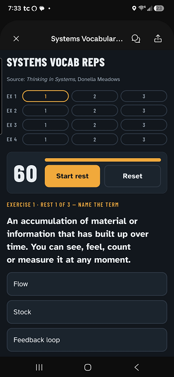

# Microlearning Skills for Claude

Two Claude skills that turn the rest periods in your workout, or any other spare minute, into a short learning session on any topic.

I built these to make use of the time between sets at the gym. A typical lifting session has about 18 rest periods, and at around 90 seconds each, that's nearly half an hour of found time per workout. These skills turn that time into a guided lesson or a tap-to-answer quiz you can work through one rest period at a time.

You can read the full story of how I built them in my article, [Found Time: How I Turned My Rest Periods Into a Classroom With AI](ARTICLE_LINK).

## What's included

**[Microlearning session](microlearning-session/SKILL.md)** runs a short learning session on any topic. It starts with a few quick questions: what you want to learn, an optional book or framework to anchor on, an optional lens from another field, and whether you want a broad overview or a deep dive. Then you choose how to learn:

- **Feynman technique:** a plain-language explanation, then you explain it back and it points out the gaps.
- **Socratic method:** one leading question at a time, so you discover the principles on your own.
- **Case study:** a real or fictional company that applied the idea, broken into the challenge, the solution and the outcome.
- **Rest-set drills:** hands off to the second skill.

**[Rest-set drills](rest-set-drills/SKILL.md)** builds a one-page quiz for your phone, laid out as exercises and sets. By default that's 6 exercises with 3 sets each, 18 drills in total. Every question is answered with a tap, using a mix of seven formats, and each one ends with a short takeaway to say out loud before your next set. At the end, you see every takeaway marked as solid or flagged for review.

The two work best together, since the session skill hands off to the drill skill when you choose testing, but you can also ask for rest-set drills on their own.

## Getting started

Claude installs skills from ZIP files, so each skill is packaged and ready to upload on the release page. The folders you see in this repo hold the same instructions as plain text, so you can read them or adapt them before you install.

1. Go to the [latest release](../../releases/latest) and download `microlearning-session.zip` and `rest-set-drills.zip` from the **Assets** list at the bottom. You don't need to unzip them.
2. Upload each ZIP to Claude by following Anthropic's guide on [using skills in Claude](https://support.claude.com/en/articles/12512180-use-skills-in-claude). It works on the web and in the desktop app.
3. Ask Claude to start a microlearning session, or ask for rest-set drills on a topic.

Avoid the green **Code > Download ZIP** button at the top of the repo. It packages the whole repository as one file, which Claude won't accept as a skill.

## Make them your own

The instructions are written in plain language, so feel free to open them up and adapt them to the way you learn. A few ideas:

- Change the default number of exercises and sets to match your program.
- Add a new learning method alongside the four included.
- Adjust the mix of question formats.

If you make changes, remember to zip the skill's folder again before uploading it, and keep the folder name the same as the skill name.

If you improve on them, I'd love to see what you come up with. Open an issue or a pull request, or find me on [LinkedIn](LINKEDIN_LINK).

## License

Released under the [MIT License](LICENSE), so you're free to use, modify and share them.
